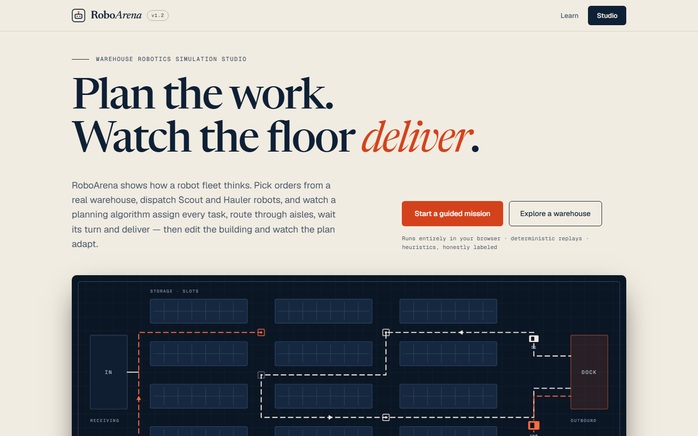
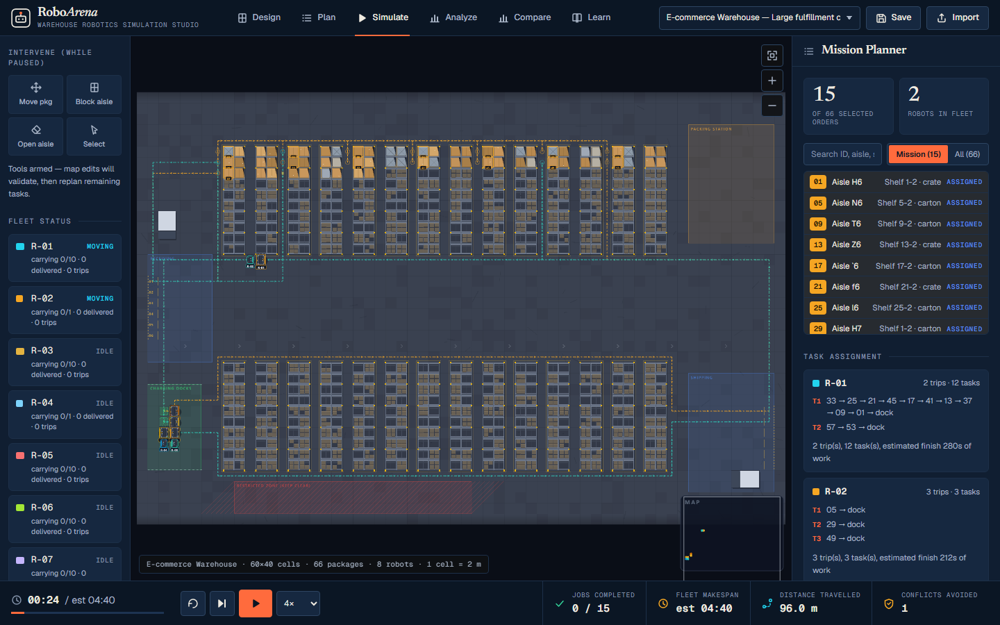
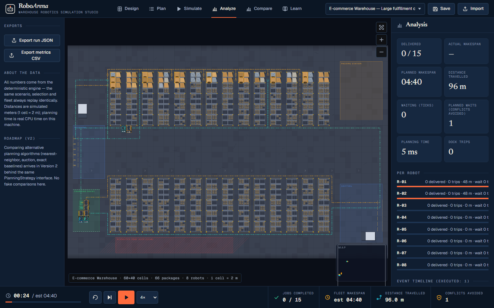
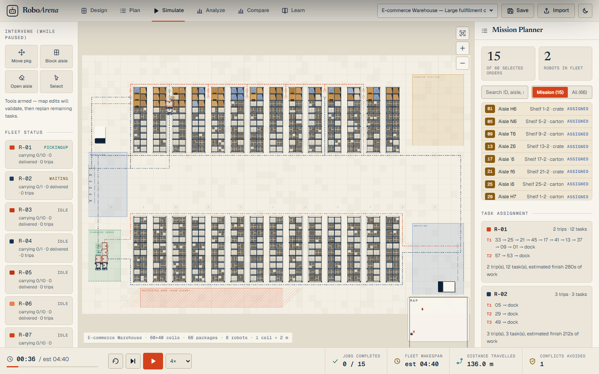
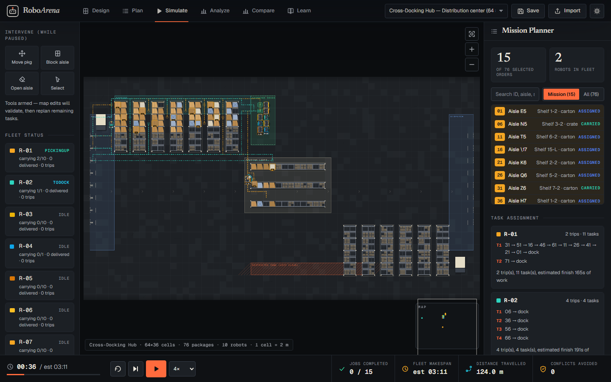

# RoboArena - Warehouse Robotics Simulation Studio

A local-first, deterministic **top-down 2D** warehouse robotics simulator. Select packages, mix
Scout (S1, capacity 1) and Hauler (H10, capacity 10) robots, and watch a capacity-aware planning
algorithm allocate tasks, route through aisles with A*, and avoid collisions with space-time
reservations - then pause, edit the warehouse, and see the plan safely recompute.

> Everything in RoboArena is simulated; results are synthetic outputs, not real factory
> statistics. The allocation heuristic makes no global-optimality claims.




| Simulate | Analyze |
|---|---|
|  |  |

The studio ships with a light (paper floor-plan) and a dark (graphite) theme:

| Light | Dark |
|---|---|
|  |  |

## Run it

```bash
npm install
npm run dev        # → http://localhost:5173
```

Other scripts:

```bash
npm run test       # Vitest engine suite (deterministic, no browser needed)
npm run typecheck  # strict TypeScript check
npm run build      # production build to dist/
npm run preview    # serve the production build
npm run e2e        # Playwright browser tests
```

Node 20+ recommended (developed on Node 24). No login, no cloud, no telemetry, no paid APIs;
works fully offline after `npm install`.

## What you can do

| Mode | What happens there |
|---|---|
| **Overview** | One-screen landing: what the product does, four warehouse presets with real object counts, one-click guided demo. |
| **Design** | Pan/zoom the warehouse, paint racks, clear aisles, add packages, undo/redo; live validation ("Map valid - mission ready"). |
| **Plan** | Click packages on the map (or load the 15-of-66 sample), activate any mix of S1/H10 robots (1–12), compute the assignment: per-robot trips, pickup order, estimated makespan, and the algorithm's reasoning. |
| **Simulate** | Deterministic playback (0.5×–4×, single-tick step, pause, reset/replay), live robot states, planned routes vs actual trails, pickup/unload animations, intervention tools (move package, block/open aisle) that validate and replan from current positions. |
| **Analyze** | Metrics derived from engine events: delivered, planned vs actual makespan, distance (simulated meters), waits, conflicts avoided, planning time, per-robot bars, event timeline, JSON/CSV export. |
| **Learn** | Illustrated A* / allocation / reservations / replanning explanations with Simple and Engineering depths. |

## The warehouse worlds

| Preset | Grid | Packages | Robots | Character |
|---|---|---|---|---|
| E-commerce Fulfillment | 60×40 | 66 | 8 | Dense double-rack aisles, receiving + packing + shipping, charging, restricted zone |
| Steel & Raw Materials | 54×38 | 60 | 6 | Wide aisles, beams/coils/crates, coil staging, heavy bay |
| Construction Supply | 50×36 | 60 | 8 | Pallets/bags/lumber, horizontal lumber racks, cement zone |
| Cross-Docking Hub | 64×36 | 76 | 10 | Sorting racks, staging lanes, dispatch racks, dual dock walls |

All four are real, serialized, editable scenarios - every package has a storage cell, a walkable
pickup service cell and a reachable dock (asserted by tests). Custom layouts can be saved to
browser storage and exported/imported as versioned JSON.

## The engine (short version)

- **Deterministic core** (`src/engine/`, no UI imports): integer ticks (1 tick = 1 simulated
  second), 1 cell/tick, pickup dwell 3 ticks, dock unload dwell 6 ticks, 1 cell = 2 m.
  Same scenario + selection + fleet ⇒ byte-identical replay regardless of framerate.
- **A\*** with Manhattan heuristic over the 4-connected grid; unreachable goals fail explicitly.
- **Allocation**: capacity-aware greedy cheapest-insertion with makespan bidding over true aisle
  distances (cached BFS fields per map revision) + bounded 2-opt intra-trip ordering.
- **Collision avoidance**: prioritized space-time A* with (cell,tick) vertex and (directed edge,
  tick) reservations, wait actions, range-checked dwells, idle robots that "make way", bounded
  priority-order retries, and explicit visible failure when no conflict-free plan exists.
- **Rendering** (`src/render/`): PixiJS 8 WebGL. Static floor/racks/art cached to a 2×
  RenderTexture per map revision; robots, packages, routes animate between ticks. The renderer
  reads engine state; it contains no business rules.

See `docs/ARCHITECTURE.md` and `docs/ALGORITHM_EXPLANATIONS.md` for the full story, including
limitations.

## Tests

```bash
npm run test
```

36 tests across 7 files: A* vs BFS on mazes, explicit unreachability, capacity/multi-trip
semantics (15 tasks with mixed S1+H10, all-S1, all-H10, fleet comparisons), corridor conflict /
head-on swap / passing-bay / idle-blocker cases, explicit planning failure, 100-seed invariant
sweep (no shared cells, no head-on swaps, capacity respected, no double-pickups), lifecycle
(pause/step/reset), byte-identical replays, all four presets valid + completable, and mid-run
replanning preserving delivered/carried state.

## Roadmap (not implemented)

Two planning strategies ship today (insertion and nearest-feasible). The following are planned
but not built:

**V2 - alternative algorithms & comparison platform**
- Nearest-next greedy baseline; cost-based balanced/auction assignment; 2-opt / swap local search
  as selectable strategies; exact small-instance solver (≤6–8 tasks) as a quality reference.
- Controlled experiment harness: identical map/tasks/seed/fleet across strategies; measured
  makespan/distance/wait/planning-time comparison with no fabricated winners.
- Side-by-side synchronized playback and strategy-tagged run snapshots (CSV export).

**V3 - research-grade exploration**
- Conflict-Based Search (CBS) / bounded-ECBS MAPF vs the prioritized planner.
- Route policy variants (Dijkstra, weighted A*, WHCA*), dynamic edge costs.
- Capacity-aware VRP solver integration (optional OR-Tools subprocess) for medium instances.
- Robustness experiments: obstruction events, flow bottlenecks, dock capacity, batteries,
  dynamic job arrivals; benchmark framework with seeds and confidence intervals.

## Repository map

```
src/engine/      deterministic core (types, grid, pathfinding, allocation, reservations, planner, simulation)
src/scenarios/   4 presets + tiny test fixture
src/render/      PixiJS 8 renderer (cached static art, dynamic robots/packages/routes)
src/state/       app store (mode, selection, playback, editor, persistence)
src/ui/          React shell (top bar, panels, overview, learn, toasts)
tests/           Vitest engine suite + fixtures
docs/            architecture, algorithm notes, screenshots/
```

## Limitations

- The allocator is a heuristic (greedy insertion + bounded 2-opt) - it does **not** prove
  optimality, and no "globally optimal" claim is made anywhere in the UI.
- Prioritized space-time planning is incomplete: a solvable congestion case can fail to find a
  plan. RoboArena reports that failure visibly instead of faking routes.
- The allocator's makespan estimate ignores congestion waits (the reservation planner resolves
  them afterwards); planned vs actual makespan can therefore differ.
- Packages are counted transport items (V1), independent of visual mass; capacity semantics are
  per-trip counts, not kilograms.
- Movement speed is constant; no acceleration, battery, torque, or load-speed physics.

## License

MIT - see [LICENSE](LICENSE).
